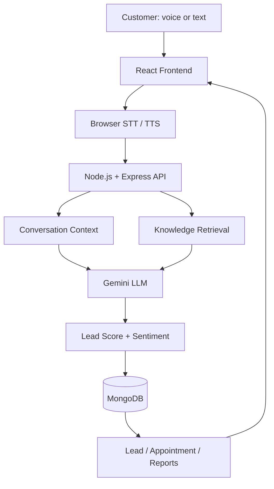

# VOXLEAD AI — System Architecture

## Components

1. **Customer:** provides spoken or typed enquiries and appointment preferences.
2. **React + Vite frontend:** landing page, authentication, voice/chat interface, dashboard, leads, knowledge, appointments and reports.
3. **Browser voice layer:** Web Speech API speech recognition (STT) and SpeechSynthesis (TTS). Availability is browser/OS dependent; text input remains available.
4. **Express REST API:** authentication, conversation orchestration and CRUD endpoints.
5. **AI service:** sends recent conversation context and retrieved company snippets to Gemini when configured. A transparent fallback is used when no API key is present.
6. **Knowledge retrieval:** retrieves matching knowledge entries with keyword overlap. This is a baseline RAG approach; semantic embeddings/vector search are a production enhancement.
7. **Qualification layer:** derives a prototype score, category and sentiment indicator from conversation text. It is a heuristic, not a validated predictive model.
8. **MongoDB/Mongoose:** stores users, leads, conversations, appointments and knowledge documents.

## Data flow

## Important implementation note

The current prototype's appointment workflow is managed through the authenticated appointment form. The AI can discuss next steps, but automatic calendar tool execution, availability checking and external CRM synchronization are not implemented yet. Do not describe these as completed capabilities in a technical evaluation.
